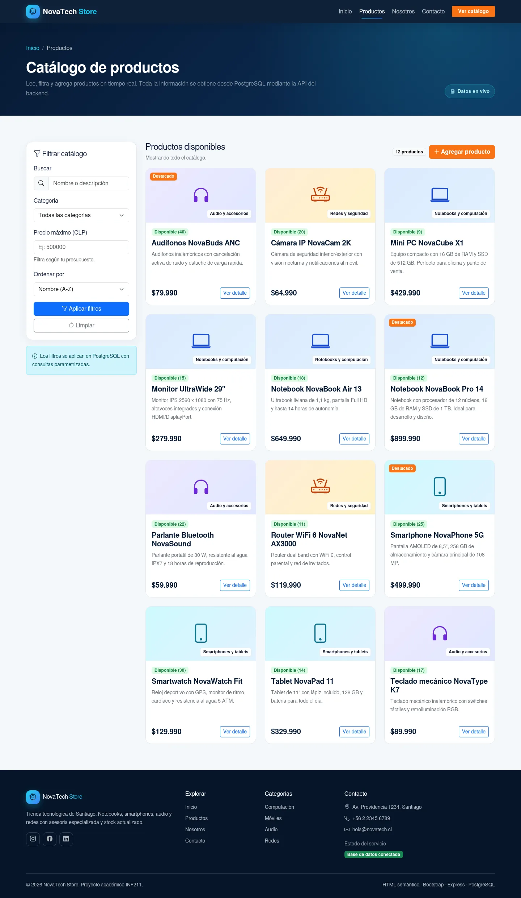

# NovaTech Store · INF211

Sitio web desarrollado para la **Evaluación Parcial de Diseño y Desarrollo de Software (INF211)**.
Incluye un frontend con Bootstrap, un backend con Express y una base de datos PostgreSQL con
lectura, filtrado e inserción de datos.

## Funcionalidades

- **Inicio:** presentación de la tienda, indicadores del catálogo, categorías y productos destacados.
- **Productos:** catálogo leído desde PostgreSQL con filtros por texto, categoría, precio máximo y orden.
- **Detalle de producto:** consulta individual a la API y ficha en un modal.
- **Agregar producto:** formulario validado en navegador y servidor que inserta un registro en PostgreSQL.
- **Nosotros:** historia, misión, visión, valores, línea de tiempo y equipo.
- **Contacto:** formulario que guarda los mensajes en la tabla `mensajes_contacto`.
- **Extras:** navegación responsive, estados de carga, mensajes de error, accesibilidad básica y
  verificación del estado de la base de datos en el pie de página.

## Capturas

| Inicio | Catálogo |
| --- | --- |
|  |  |

| Nosotros | Contacto |
| --- | --- |
|  |  |

Vista móvil: 

## Tecnologías

| Capa | Tecnología |
| --- | --- |
| Frontend | HTML5 semántico, CSS3, JavaScript (módulos ES), Bootstrap 5.3.3 y Bootstrap Icons |
| Backend | Node.js, Express 4, `pg`, `cors`, `dotenv` |
| Base de datos | PostgreSQL 14+ |
| Control de versiones | Git |

Bootstrap se incluye de forma local en `public/vendor/`, por lo que el sitio funciona sin depender
de un CDN.

## Estructura del proyecto

```text
backend-consulta-postgresql-main/
├── database/
│   └── dump.sql              # Esquema y datos de demo_web
├── docs/
│   └── capturas/             # Evidencia visual del sitio
├── public/                   # Frontend servido por Express
│   ├── css/
│   │   └── estilos.css
│   ├── js/
│   │   ├── api.js            # Cliente HTTP de la API
│   │   ├── componentes.js    # Tarjetas, alertas y utilidades de UI
│   │   ├── comun.js          # Año, estado de la API y tooltips
│   │   ├── inicio.js
│   │   ├── productos.js
│   │   └── contacto.js
│   ├── vendor/               # Bootstrap e iconos (licencias incluidas)
│   ├── index.html
│   ├── productos.html
│   ├── nosotros.html
│   ├── contacto.html
│   ├── 404.html
│   └── favicon.svg
├── src/
│   ├── routes/
│   │   ├── categorias.js
│   │   ├── contacto.js
│   │   ├── estadisticas.js
│   │   └── productos.js
│   ├── utils/
│   │   ├── http.js           # ErrorHttp y asyncHandler
│   │   └── validacion.js     # Validación de entradas
│   ├── db.js                 # Pool y consultas parametrizadas
│   └── server.js             # Configuración de Express y arranque
├── .env.example
├── .gitignore
├── package.json
└── README.md
```

## Puesta en marcha

### 1. Requisitos

- Node.js 18 o superior.
- PostgreSQL 14 o superior en ejecución.

### 2. Crear la base de datos e importar el dump

Opción recomendada, creando un usuario exclusivo para la aplicación:

```bash
sudo -u postgres psql -c "CREATE ROLE demo_user WITH LOGIN PASSWORD 'demo_user_2026';"
sudo -u postgres psql -c "CREATE DATABASE demo_web OWNER demo_user ENCODING 'UTF8';"
psql -U demo_user -h localhost -d demo_web -f database/dump.sql
```

Si prefieres usar el usuario `postgres`:

```bash
sudo -u postgres createdb demo_web
sudo -u postgres psql -d demo_web -f database/dump.sql
```

Verifica la carga:

```bash
psql -U demo_user -h localhost -d demo_web -c "SELECT COUNT(*) FROM demo_productos;"
```

El dump contiene 4 categorías, 12 productos y 1 mensaje de ejemplo.

### 3. Configurar las variables de entorno

```bash
cp .env.example .env
```

Edita `.env` con tus credenciales:

```dotenv
PORT=3000
DB_HOST=localhost
DB_PORT=5432
DB_DATABASE=demo_web
DB_USER=demo_user
DB_PASSWORD=demo_user_2026
DB_SSL=false
FRONTEND_URL=
```

> `.env` está incluido en `.gitignore`. Nunca subas credenciales reales al repositorio.

### 4. Instalar dependencias y ejecutar

```bash
npm install
npm start
```

Abre <http://localhost:3000>.

Para desarrollo con recarga automática:

```bash
npm run dev
```

### 5. Regenerar el dump (opcional)

Si modificas la base de datos y quieres actualizar el respaldo:

```bash
pg_dump -U postgres -h localhost --no-owner --no-privileges -d demo_web -f database/dump.sql
```

## API

| Método | Ruta | Descripción |
| --- | --- | --- |
| GET | `/api/salud` | Estado de la conexión con PostgreSQL |
| GET | `/api/categorias` | Categorías con cantidad de productos |
| GET | `/api/productos` | Listado con filtros opcionales |
| GET | `/api/productos/:id` | Detalle de un producto |
| POST | `/api/productos` | Inserta un producto |
| POST | `/api/contacto` | Guarda un mensaje de contacto |
| GET | `/api/estadisticas` | Totales y precio promedio |

### Filtros de `GET /api/productos`

| Parámetro | Ejemplo | Descripción |
| --- | --- | --- |
| `buscar` | `notebook` | Busca en nombre y descripción (`ILIKE`) |
| `categoria` | `1` | Filtra por `categoria_id` |
| `precioMax` | `500000` | Precio menor o igual al valor |
| `destacados` | `true` | Solo productos destacados |
| `orden` | `precio_asc` | `nombre`, `precio_asc`, `precio_desc` o `recientes` |

### Ejemplos con `curl`

```bash
# Lectura con filtros
curl "http://localhost:3000/api/productos?categoria=1&precioMax=700000&orden=precio_asc"

# Inserción de un producto
curl -X POST http://localhost:3000/api/productos \
  -H "Content-Type: application/json" \
  -d '{
    "nombre": "Webcam NovaCam Full HD",
    "descripcion": "Cámara web 1080p con micrófono integrado y enfoque automático.",
    "precio": 49990,
    "stock": 10,
    "categoria_id": 3,
    "destacado": false
  }'

# Mensaje de contacto
curl -X POST http://localhost:3000/api/contacto \
  -H "Content-Type: application/json" \
  -d '{
    "nombre": "Ana Pérez",
    "email": "ana@example.com",
    "asunto": "Consulta por despacho",
    "mensaje": "Hola, quisiera saber si realizan envíos a Concepción."
  }'
```

## Modelo de datos

```text
demo_categorias (1) ──── (N) demo_productos
categoria_id                 categoria_id (FK)

mensajes_contacto  (tabla independiente para el formulario)
```

- `demo_categorias`: `categoria_id`, `nombre`, `descripcion`, `creado_en`.
- `demo_productos`: `producto_id`, `nombre`, `descripcion`, `precio`, `stock`, `destacado`,
  `categoria_id`, `creado_en`.
- `mensajes_contacto`: `mensaje_id`, `nombre`, `email`, `asunto`, `mensaje`, `creado_en`.

El esquema incluye restricciones `CHECK` para precio y stock, clave foránea con `ON DELETE RESTRICT`
e índices por categoría y precio.

## Buenas prácticas aplicadas

- Consultas **parametrizadas** para evitar inyección SQL.
- Validación y normalización de datos en el servidor (`src/utils/validacion.js`).
- Manejo centralizado de errores y respuestas JSON consistentes.
- Separación de responsabilidades: rutas, acceso a datos, validación y UI.
- Variables sensibles fuera del repositorio.
- HTML semántico, etiquetas `label`, `aria-live`, foco visible y enlace para saltar al contenido.
- Estados de carga, vacío y error en la interfaz.
- Dependencias de frontend incluidas localmente para evitar fallas por CDN.

## Relación con la rúbrica

| Criterio | Dónde se evidencia |
| --- | --- |
| 1. Uso de Git | Repositorio local con commits; `.gitignore` configurado |
| 2. Etiquetas semánticas y dump | `public/*.html` y `database/dump.sql` |
| 3. Conexión a BD (lectura y filtrado) | `src/routes/productos.js`, `public/js/productos.js` |
| 4. Código limpio | `src/` modular, funciones pequeñas, sin archivos duplicados |
| 5. Estructura de carpetas | `src/`, `public/`, `database/` |
| 6. Uso de Bootstrap | `public/vendor/bootstrap/` y componentes en todas las páginas |
| 7. Estructura de página web (mínimo 3) | Inicio, Productos, Nosotros y Contacto |
| 8. Profesionalismo | Navegación responsive, diseño consistente, estados y accesibilidad |

## Nota académica

Antes de entregar, completa en el PDF de la evaluación el nombre del estudiante y el enlace del
repositorio remoto (GitHub, GitLab o similar). Este proyecto ya incluye un repositorio Git local
con commits; solo falta asociarlo a tu cuenta y subirlo.
