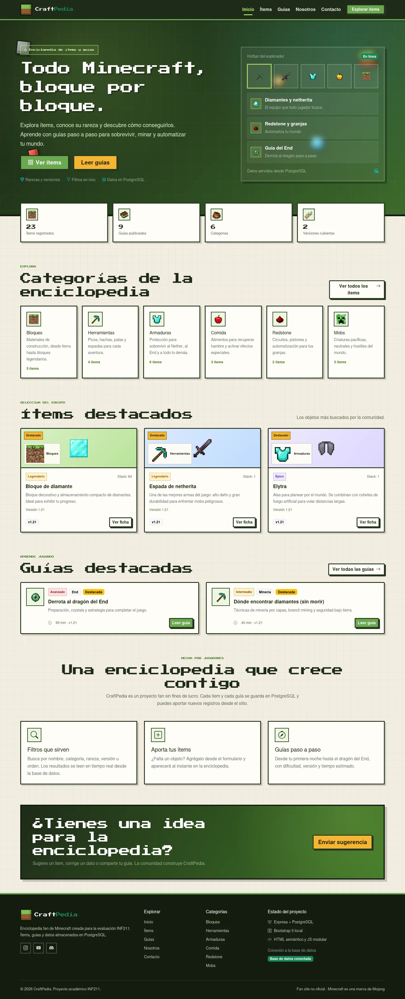
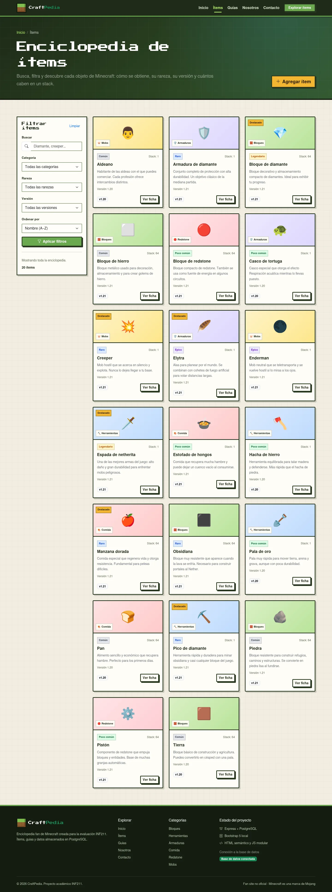
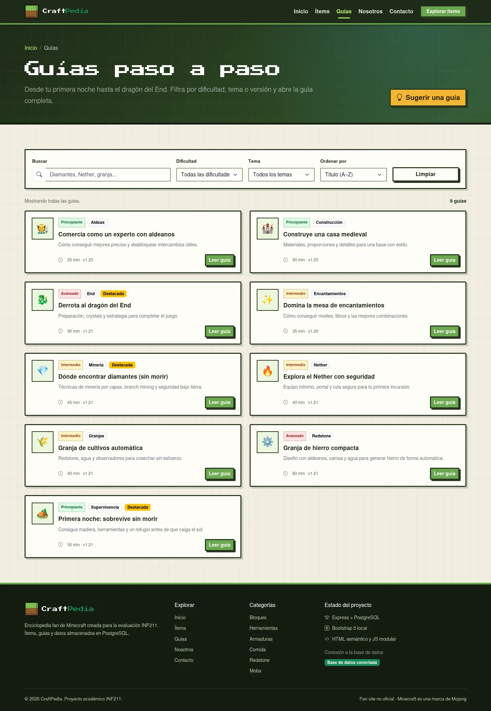
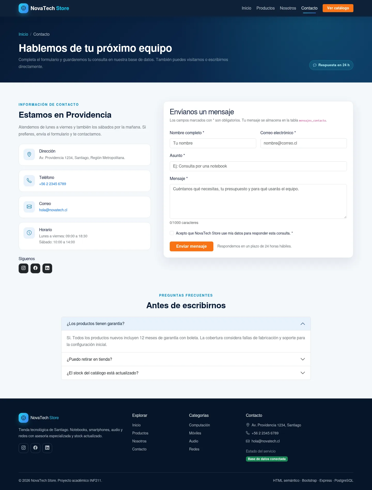
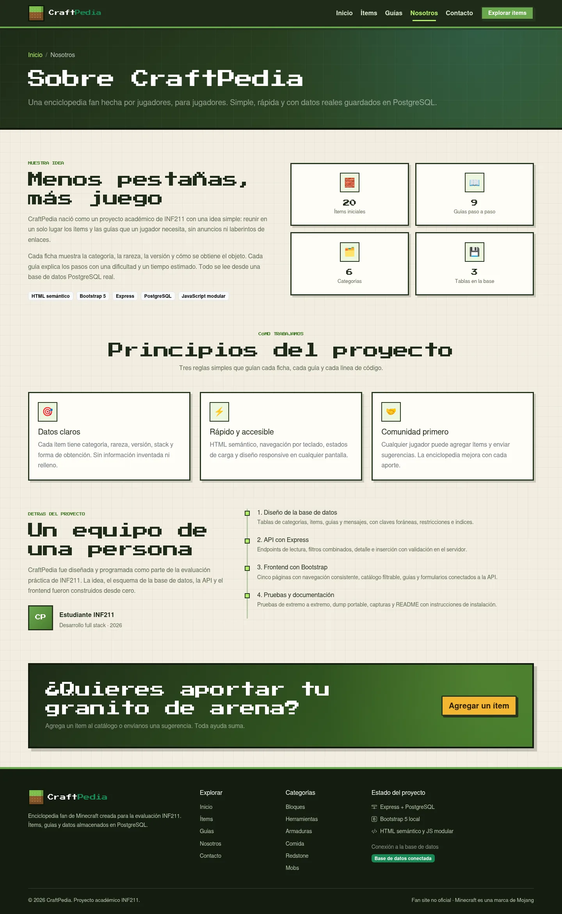
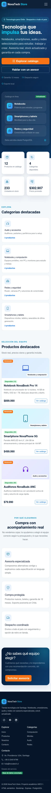

# CraftPedia · INF211

Enciclopedia fan de **Minecraft** construida con **Node.js + Express + PostgreSQL** y un frontend
estático con **Bootstrap 5**. Permite leer, filtrar e insertar datos reales desde la web.

> Proyecto académico para la evaluación práctica de INF211. No es un sitio oficial de Minecraft.



## Contenido

- [Características](#características)
- [Tecnologías](#tecnologías)
- [Estructura del proyecto](#estructura-del-proyecto)
- [Requisitos](#requisitos)
- [Instalación](#instalación)
- [Importar el dump](#importar-el-dump)
- [Ejecutar el proyecto](#ejecutar-el-proyecto)
- [API](#api)
- [Base de datos](#base-de-datos)
- [Pruebas realizadas](#pruebas-realizadas)
- [Relación con la rúbrica](#relación-con-la-rúbrica)

## Características

- **Inicio:** indicadores en vivo, categorías, ítems destacados y guías destacadas.
- **Ítems:** catálogo leído desde PostgreSQL con filtros por texto, categoría, rareza, versión y orden.
- **Detalle de ítem:** consulta individual a la API y ficha completa en un modal.
- **Agregar ítem:** formulario validado en navegador y servidor que inserta un registro en PostgreSQL.
- **Guías:** listado filtrable por dificultad, tema y texto, con guía completa en un modal.
- **Contacto:** formulario que inserta mensajes en la tabla `mensajes_contacto`.
- **404 personalizada**, navegación consistente, diseño responsive y accesibilidad básica.
- Bootstrap 5.3.3 e iconos incluidos **localmente** (no depende de CDN).
- Texturas reales de ítems, bloques y guías incluidas en `public/assets/minecraft`.
- Consultas SQL **parametrizadas** y validación del lado del servidor.

## Tecnologías

| Capa | Tecnología |
| --- | --- |
| Frontend | HTML5 semántico, CSS3, JavaScript ES Modules, Bootstrap 5.3.3 |
| Backend | Node.js, Express 4, `pg`, `dotenv` |
| Base de datos | PostgreSQL 14+ |
| Control de versiones | Git |

## Estructura del proyecto

```text
.
├── database/
│   └── dump.sql              # Esquema + datos completos
├── docs/
│   └── capturas/             # Capturas para la documentación
├── public/                   # Frontend servido por Express
│   ├── css/
│   │   └── estilos.css
│   ├── js/
│   │   ├── api.js            # Cliente fetch y manejo de errores
│   │   ├── comun.js          # Utilidades compartidas
│   │   ├── componentes.js    # Tarjetas y alertas seguras
│   │   ├── inicio.js
│   │   ├── items.js
│   │   ├── guias.js
│   │   └── contacto.js
│   ├── assets/
│   │   └── minecraft/        # Texturas PNG de ítems y bloques
│   ├── vendor/               # Bootstrap, iconos y fuente local
│   ├── index.html
│   ├── items.html
│   ├── guias.html
│   ├── nosotros.html
│   ├── contacto.html
│   └── 404.html
├── src/
│   ├── routes/
│   │   ├── items.js
│   │   ├── guias.js
│   │   ├── meta.js
│   │   ├── estadisticas.js
│   │   └── contacto.js
│   ├── utils/
│   │   ├── http.js
│   │   └── validacion.js
│   ├── constantes.js
│   ├── db.js
│   └── server.js
├── .env.example
├── .gitignore
├── package.json
└── README.md
```

## Requisitos

- Node.js 18 o superior
- PostgreSQL 14 o superior en ejecución

## Instalación

```bash
git clone <URL_DEL_REPOSITORIO>
cd evaluacion
npm install
cp .env.example .env
```

Edita `.env` con tus credenciales:

```env
PORT=3000
DB_HOST=localhost
DB_PORT=5432
DB_DATABASE=craftpedia
DB_USER=craftpedia_user
DB_PASSWORD=tu_clave
DB_SSL=false
FRONTEND_URL=
```

### Crear el usuario y la base de datos

```bash
sudo -u postgres psql <<'SQL'
CREATE ROLE craftpedia_user WITH LOGIN PASSWORD 'tu_clave';
CREATE DATABASE craftpedia OWNER craftpedia_user ENCODING 'UTF8';
ALTER SCHEMA public OWNER TO craftpedia_user;
SQL
```

## Importar el dump

El archivo `database/dump.sql` contiene el esquema completo, índices, restricciones y datos de
ejemplo (6 categorías, 23 ítems, 9 guías y 1 mensaje).

```bash
psql -U craftpedia_user -h localhost -d craftpedia -f database/dump.sql
```

Si prefieres usar el usuario `postgres`:

```bash
sudo -u postgres createdb craftpedia
sudo -u postgres psql -d craftpedia -f database/dump.sql
```

> Si importas con `postgres` pero el backend se conecta como `craftpedia_user`, entrega los permisos
> necesarios:
>
> ```sql
> GRANT ALL PRIVILEGES ON ALL TABLES IN SCHEMA public TO craftpedia_user;
> GRANT ALL PRIVILEGES ON ALL SEQUENCES IN SCHEMA public TO craftpedia_user;
> ```
>
> La opción recomendada (importar como `craftpedia_user`) evita este paso.

Verifica la carga:

```bash
psql -U craftpedia_user -h localhost -d craftpedia -c \
  "SELECT (SELECT COUNT(*) FROM items) AS items, (SELECT COUNT(*) FROM guias) AS guias;"
```

## Ejecutar el proyecto

```bash
npm start
```

Abre **http://localhost:3000**. Para desarrollo con recarga automática:

```bash
npm run dev
```

El backend sirve el frontend y la API desde el mismo origen, por lo que no necesitas un servidor
estático aparte.

## API

Todas las respuestas son JSON. Los errores usan el formato:

```json
{ "mensaje": "Descripción del error" }
```

| Método | Ruta | Descripción |
| --- | --- | --- |
| GET | `/api/salud` | Estado de la conexión a PostgreSQL |
| GET | `/api/estadisticas` | Totales para la página de inicio |
| GET | `/api/meta` | Categorías, versiones, temas, rarezas y dificultades |
| GET | `/api/items` | Listado de ítems con filtros opcionales |
| GET | `/api/items/:id` | Detalle de un ítem |
| POST | `/api/items` | Inserta un ítem |
| GET | `/api/items/versiones` | Versiones disponibles |
| GET | `/api/guias` | Listado de guías con filtros opcionales |
| GET | `/api/guias/:id` | Detalle de una guía |
| GET | `/api/guias/temas` | Temas disponibles |
| POST | `/api/contacto` | Guarda un mensaje de contacto |

### Filtros de `GET /api/items`

| Parámetro | Ejemplo | Descripción |
| --- | --- | --- |
| `buscar` | `diamante` | Busca en nombre, descripción y obtención |
| `categoria` | `2` | ID de categoría |
| `rareza` | `Legendario` | Común, Poco común, Raro, Épico o Legendario |
| `version` | `1.21` | Versión exacta |
| `destacados` | `true` | Solo ítems destacados |
| `orden` | `rareza` | `nombre`, `rareza`, `stack_desc` o `recientes` |

### Filtros de `GET /api/guias`

| Parámetro | Ejemplo | Descripción |
| --- | --- | --- |
| `buscar` | `nether` | Busca en título, resumen y contenido |
| `dificultad` | `Avanzado` | Principiante, Intermedio o Avanzado |
| `tema` | `Minería` | Tema exacto |
| `destacadas` | `true` | Solo guías destacadas |
| `orden` | `dificultad` | `titulo`, `dificultad` o `recientes` |

### Ejemplos con `curl`

```bash
# Lectura con filtros
curl "http://localhost:3000/api/items?categoria=2&rareza=Raro&orden=nombre"

# Búsqueda por texto
curl "http://localhost:3000/api/items?buscar=diamante"

# Detalle
curl "http://localhost:3000/api/items/1"

# Inserción de un ítem
curl -X POST http://localhost:3000/api/items \
  -H "Content-Type: application/json" \
  -d '{
    "nombre": "Bloque de amatista",
    "descripcion": "Bloque decorativo que produce sonidos al caminar sobre él.",
    "obtencion": "Crafteando con 4 fragmentos de amatista.",
    "categoria_id": 1,
    "rareza": "Poco común",
    "version": "1.21",
    "stack_max": 64,
    "icono": "diamond",
    "destacado": false
  }'

# Inserción de un mensaje
curl -X POST http://localhost:3000/api/contacto \
  -H "Content-Type: application/json" \
  -d '{
    "nombre": "Alex",
    "email": "alex@example.com",
    "asunto": "Sugerencia de guía",
    "mensaje": "Me gustaría una guía sobre cómo domesticar gatos."
  }'
```

## Base de datos

```text
categorias (1) ──── (N) items

guias (independiente)

mensajes_contacto (independiente)
```

| Tabla | Campos principales |
| --- | --- |
| `categorias` | `categoria_id`, `nombre`, `descripcion`, `icono`, `slug` |
| `items` | `item_id`, `nombre`, `descripcion`, `obtencion`, `categoria_id`, `rareza`, `version`, `stack_max`, `icono`, `destacado` |
| `guias` | `guia_id`, `titulo`, `resumen`, `contenido`, `tema`, `dificultad`, `version`, `duracion`, `icono`, `destacada` |
| `mensajes_contacto` | `mensaje_id`, `nombre`, `email`, `asunto`, `mensaje`, `creado_en` |

Restricciones destacadas:

- Clave foránea `items.categoria_id → categorias.categoria_id` con `ON DELETE RESTRICT`.
- `CHECK` para `rareza`, `dificultad` y `stack_max` (1 a 64).
- Índices en categoría, rareza, versión, tema y dificultad.

## Pruebas realizadas

- Importación del dump en una base limpia (`craftpedia_test`) con conteos correctos.
- Pruebas de extremo a extremo con Playwright:
  - Inicio: estadísticas, categorías, ítems y guías destacadas.
  - Ítems: lectura, filtro por categoría, búsqueda, orden y limpieza.
  - Detalle de ítem en modal.
  - Inserción de un ítem desde el formulario.
  - Contacto: inserción de mensaje y precarga desde una ficha.
  - Guías: listado, filtro y modal de detalle.
  - Página 404.
- Sin errores de consola ni excepciones de JavaScript.
- Datos de prueba eliminados y secuencias restablecidas después de las pruebas.

## Capturas

| Inicio | Ítems |
| --- | --- |
|  |  |

| Guías | Contacto |
| --- | --- |
|  |  |

| Nosotros | Móvil |
| --- | --- |
|  |  |

## Relación con la rúbrica

| Criterio | Dónde se cumple |
| --- | --- |
| 1. Repositorio Git | Historial de commits en la raíz del proyecto |
| 2. HTML semántico y dump completo | Páginas en `public/`, dump en `database/dump.sql` |
| 3. Conexión a BD (lectura y filtrado) | `src/db.js`, `src/routes/items.js`, `src/routes/guias.js` |
| 4. Código limpio y ordenado | Separación `src/routes`, `src/utils`, `public/js` |
| 5. Estructura de carpetas | `database/`, `docs/`, `public/`, `src/` |
| 6. Bootstrap | `public/vendor/bootstrap/` y clases en todas las páginas |
| 7. Mínimo 3 secciones | Inicio, Ítems, Guías, Nosotros y Contacto |
| 8. Navegación y diseño profesional | Navbar/footer consistentes, responsive, estados de carga y error |

## Licencia

Proyecto académico de uso educativo. Minecraft es una marca registrada de Mojang Studios; este sitio
no está afiliado ni respaldado por Mojang. Las texturas de ítems y bloques incluidas en
`public/assets/minecraft` pertenecen a Mojang Studios y se usan únicamente con fines educativos.
